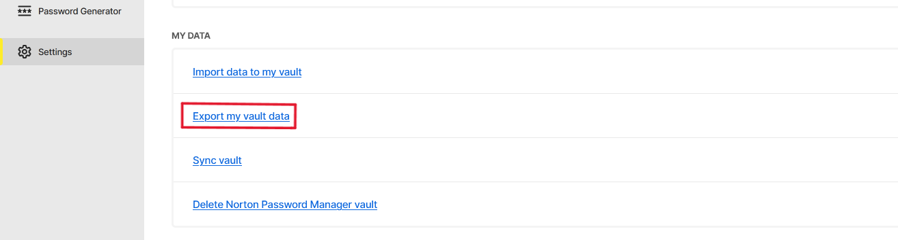
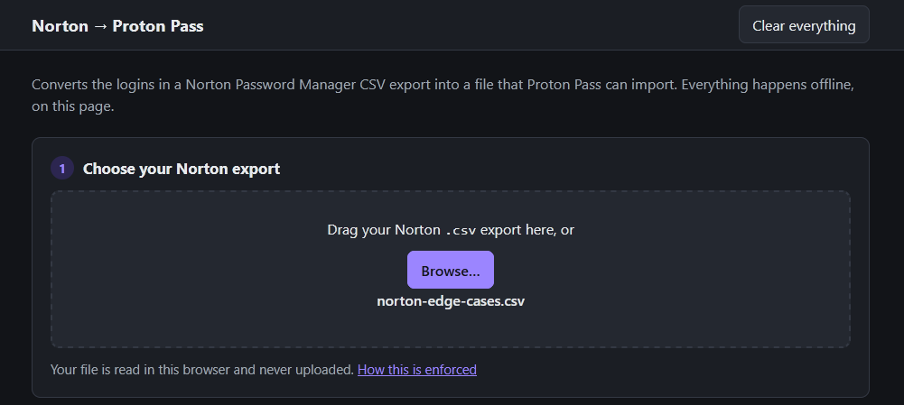
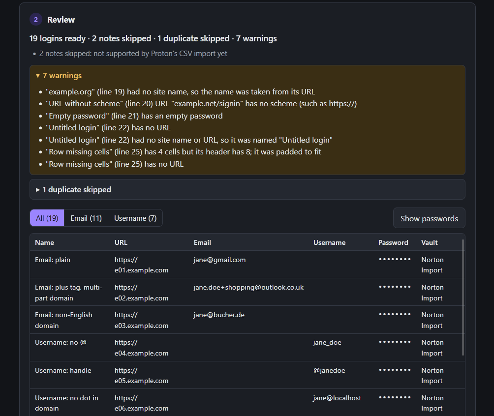
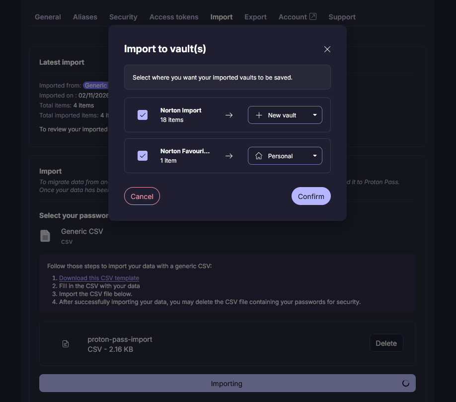

# Norton to Proton Pass

**An offline converter that turns a Norton Password Manager CSV export into a file Proton Pass can import.**

Proton Pass has no built-in importer for Norton. This tool converts your Norton logins into Proton's Generic CSV format. It's a single HTML file that runs in your browser and works with the network switched off. Your passwords never leave your computer.

> Not affiliated with Norton or Proton. This is an independent open-source project. It is not endorsed or sponsored by Gen Digital (Norton) or Proton AG. Norton Password Manager and Proton Pass are trademarks of their respective owners.

- [Download](#download)
- [How to use it](#how-to-use-it)
- [What gets converted](#what-gets-converted)
- [Not supported yet](#not-supported-yet)
- [Security](#security)
- [Run it from source](#run-it-from-source)

## Download

**[Download norton-to-proton-pass.html](https://github.com/willhuddleston/norton-to-proton-pass/releases/latest/download/norton-to-proton-pass.html)** from the [latest release](https://github.com/willhuddleston/norton-to-proton-pass/releases/latest).

There's nothing to install. Open the file in any modern browser (Chrome, Edge, Firefox or Safari). To check that the file hasn't been tampered with, download `norton-to-proton-pass.html.sha256` from the same release and [verify the checksum](#verify-the-download).

## How to use it

1. **Export your vault from Norton Password Manager:**
   1. In Norton Password Manager, open **Settings**.
   2. Scroll down to the **MY DATA** section and click **Export my vault data**.
   3. Click **Export**, then enter your vault password when asked.

   Norton saves your vault as a CSV file. This file contains all your passwords unencrypted, so keep it somewhere private and delete it when you're done (step 7).

   

2. **Open `norton-to-proton-pass.html`** in your browser. You can switch off Wi-Fi first if you like. The tool doesn't need the internet.

3. **Drop your Norton export onto the page**, or click **Browse…** and choose it.

   

4. **Review the result.** The summary shows how many logins are ready and what was skipped. For example: *214 logins ready · 12 notes skipped · 2 duplicates skipped · 3 warnings*.
   - Open **warnings** to see any rows that need a look, such as an empty password or a URL without `https://`.
   - Open **duplicates skipped** to see exactly which rows were left out.
   - Use the **All / Email / Username** filter to see where each Norton user name went.
   - Passwords are hidden until you click **Show passwords**.

   

5. **Optional: change the options** under **Advanced options**. The preview updates as you change them. See [Options](#options).

6. **Click Download proton-pass-import.csv**, then import it into Proton Pass:
   1. In Proton Pass, open **Settings → Import → Generic CSV** and upload the file.
   2. On the vault screen, choose or create a vault for each group: "Norton Import", plus "Norton Favourites" if you have any favourites.
   3. Spot-check a few logins.

   

7. **Clean up.** Delete the Norton export and `proton-pass-import.csv`, then empty your trash or recycle bin. Click **Clear everything** on the page, or just close the tab.

## What gets converted

Each Norton login becomes one Proton login, in the same order as your Norton export.

| Proton field | Comes from Norton | Notes |
| --- | --- | --- |
| Name | Site Name | If it's empty, the website's name is used (for example `example.org`). If there's no URL either, it's called "Untitled login". |
| URL | Login URL | Copied exactly. |
| Email or Username | User Name | Email addresses go to Email and everything else goes to Username. You can change this in the options. |
| Password | Password | Copied exactly. |
| Note | Notes | Copied exactly, including line breaks. |
| Vault group | Favorite | Favourites form their own group on Proton's import screen. |

### Options

| Option | Choices | Default |
| --- | --- | --- |
| User Name goes to | Auto · Always Username · Always Email · Both (emails go into both fields) | Auto |
| Vault label | Any text, or blank | Norton Import |
| Norton favourites | Own group (label can be changed) · Same group as other logins · Same group, with "Norton favourite" added to the note | Own group, "Norton Favourites" |
| Exact duplicates | Skip · Keep | Skip |

Proton doesn't create vaults from the vault label. It groups the rows by label on its import screen, and you choose or create a vault for each group.

A row only counts as an **exact duplicate** if its name, URL, user name, password and note all match an earlier row.

### Warnings

Warnings don't stop the conversion. They point out rows you may want to check after importing:

- an empty password
- a missing URL
- a URL with no scheme (no `https://`)
- a name that was filled in from the URL, or set to "Untitled login"
- a row with more or fewer cells than its header (it is padded or trimmed to fit)

Each warning names the row by its site and its line number in the Norton file.

## Not supported yet

- **Secure notes.** Proton's Generic CSV import would turn them into logins, so they're skipped and counted. Support is planned for a future version that writes Proton's own export format.
- **Cards, addresses and other item types.** These are skipped and counted. If you have them, see [CONTRIBUTING.md](CONTRIBUTING.md#adding-a-new-item-type) to help add support.
- **2FA / TOTP codes.** Norton doesn't include them in its export, so set up 2FA again in Proton Pass.
- **Norton's "Secure" setting** (ask for the vault password before showing an item). Proton has no equivalent and encrypts everything, so it's ignored.

## Security

The tool handles your passwords, so it's built to keep them on your computer. It does this in four ways:

- **No network access.** The released file includes a Content-Security-Policy that tells the browser to block every request: no scripts, fonts, images or analytics from anywhere else. You can confirm this in your browser's developer tools (Network tab), or run it with the network switched off.
- **Nothing stored.** No cookies, localStorage, sessionStorage or IndexedDB. Closing the tab or clicking **Clear everything** removes your data from the page.
- **Nothing logged.** Nothing from your file is written to the browser console.
- **Passwords hidden by default.** They're masked in the preview until you click **Show passwords**.

The converted file is created in your browser and saved with your browser's normal download. The page's one external link (to this section) only opens if you click it.

The released file is one readable HTML file with no minified code, so you can read every line of it. It's built from the code in this repository by a [public GitHub Actions workflow](.github/workflows/release.yml). An automated test checks that the source has no network, storage or console code.

To report a security problem, see [SECURITY.md](SECURITY.md).

### Verify the download

Each release publishes the SHA-256 checksum of `norton-to-proton-pass.html` in its release notes and in `norton-to-proton-pass.html.sha256`. Put both files in the same folder, open a terminal there and run the command for your system.

**Windows (PowerShell)**

```powershell
(Get-FileHash .\norton-to-proton-pass.html -Algorithm SHA256).Hash -eq (Get-Content .\norton-to-proton-pass.html.sha256).Split(' ')[0]
```

This prints `True` if the file matches.

**macOS**

```sh
shasum -a 256 -c norton-to-proton-pass.html.sha256
```

**Linux**

```sh
sha256sum -c norton-to-proton-pass.html.sha256
```

On macOS and Linux, the command prints `norton-to-proton-pass.html: OK` if the file matches. If you get anything else, don't use the file.

## Run it from source

You need [Node.js](https://nodejs.org/) (current LTS) for the tests and the build. The tool has no dependencies, so there's no `npm install`.

```sh
git clone https://github.com/willhuddleston/norton-to-proton-pass.git
cd norton-to-proton-pass
npm test          # run the tests
npm run build     # creates dist/norton-to-proton-pass.html
```

You can also open `src/index.html` directly in a browser while developing. It loads the scripts as separate files, so it has no Content-Security-Policy; the built file adds one. Builds are reproducible: `npm run build` on a clean checkout of a release tag produces a file with the same checksum as the release.

See [CONTRIBUTING.md](CONTRIBUTING.md) for how the code is organised.

## Licence

[MIT](LICENSE)
